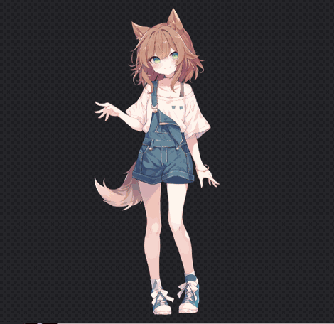

# waifu2d-wpf

A Windows port of [libwaifu](https://github.com/ling0322/libwaifu)'s waifu2d: a layered
illustration, as a Photoshop document, made to move -- blink, gaze, head turn, breathing, hair
physics, and more. No model runs here; a `.psd` out of See-through (`img2layers`), or anything
layered the way See-through or [Anime2.5DRig](https://github.com/852wa/Anime2.5DRig) names its
layers, is opened and driven about.



The macOS reference is `waifu-app/swiftui` (`Rig.swift`, `RigMotion.swift`, `RigMetal.swift`,
`PSD.swift`), which draws its mesh grid with Metal. This port draws it with
[SkiaSharp](https://github.com/mono/SkiaSharp) instead -- every part a triangle grid over its
picture, moved vertex by vertex on the CPU, eye whites rendered into mask surfaces the irises are
clipped by.

Beyond a straight port it adds, for trying the rig out: volume-driven lip sync (mic through
winmm, or made-up babble), smile / brows / wink / body-twist controls, nod / shake / jump
gestures, wind gusts on the hair and hem springs, and grabbing a swinging part with the mouse.

## Build

Windows with .NET Framework 4.8 and PowerShell; no Visual Studio, no .NET SDK, no XAML.

```powershell
setup.ps1    # once: nuget.exe + Roslyn toolset + SkiaSharp into packages/
build.ps1    # bin\waifu2d.exe
```

## Run

```
waifu2d.exe path\to\character.psd [mouth=0.5 smile=0.8 twist=0.3 talk=1 jump=1 shake=1]
```

or drop a `.psd` on the window / `Open a .psd…`. Command-line `key=value` pairs pose the rig
directly, for shots like the one above.

## Controls

- **Move the mouse over the picture** -- the head and eyes follow.
- **Motion**: pointer follow, idle sway, look-around, hair physics, nod and body-follow amounts.
- **Blink**: automatic or by the `Eyes open` slider; `Blink Now` blinks once.
- **Talk**: `Auto talk` babbles; `Microphone` moves the mouth to the mic's loudness;
  `Mouth open` opens it by hand.
- **Expression**: `Smile`, `Brows`, `Wink left/right`, `Twist`; `Nod`, `Shake`, `Jump` buttons
  (Space jumps too).
- **World**: `Wind` and its gusts; drag the hair or skirt to pull it, let go and it swings back.

## Getting a .psd

Any PSD whose layers are named the See-through way (`face`, `front hair`, `back hair`,
`eyewhite`, `irides`, `eyelash`, `eyebrow`, `mouth`, `nose`, `neck`, `topwear`, `handwear`,
`bottomwear`, `legwear`, `footwear`, `tail`, ...) works -- `-l` and `-r` suffixes split a pair.
The `img2layers` tool in libwaifu turns a single illustration into exactly such a document
(parts + hidden `depth/` group). Simpler hand-layered PSDs animate too, just with fewer parts
recognized.

## Licence

MIT, as libwaifu is: this is a port of its Swift waifu2d (`Copyright (c) 2026 Xiaoyang Chen`,
`waifu-app/swiftui/Sources/Waifu/`), keeping its licence and header comments. The rig itself
follows Anime2.5DRig's approach (WebGL, MIT). SkiaSharp is MIT. The sample character in the
screenshot is a See-through test asset layered by its own model.
